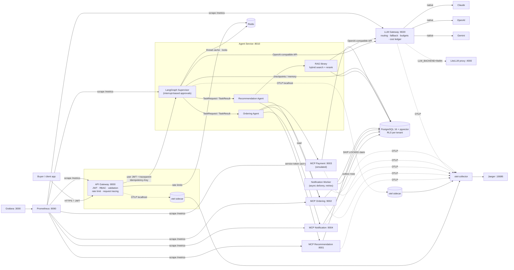
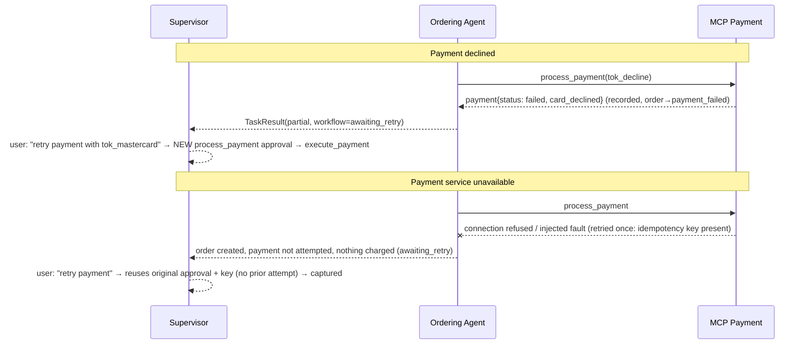
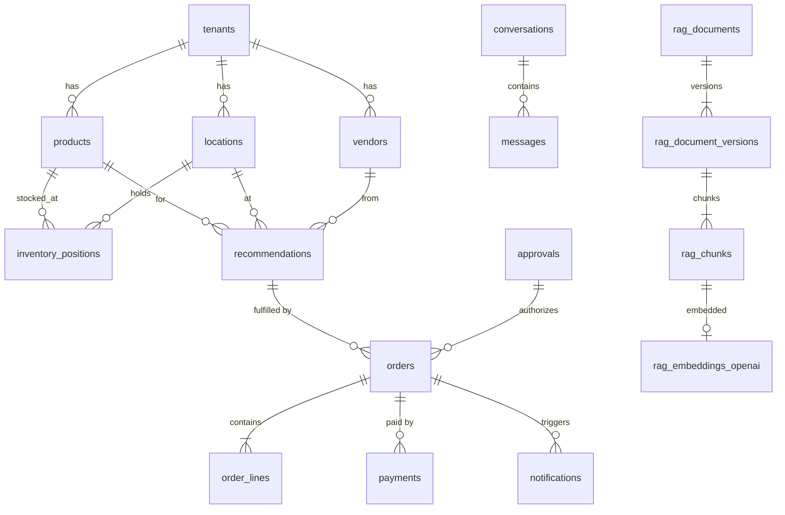
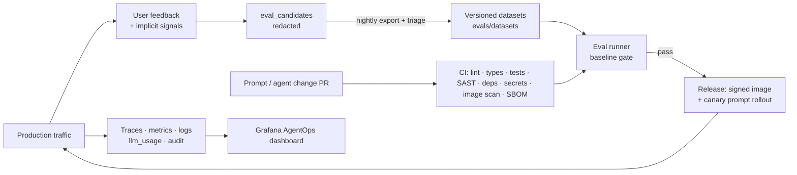

# Architecture

## 1. System overview



### Component responsibilities

| Component | Responsibility | Key files |
|---|---|---|
| **API Gateway** | Public edge: JWT authentication, role permissions, pydantic validation + body limits, per-user Redis rate limiting, `X-Request-ID` and W3C trace propagation, security headers, RFC 9457 errors, dev-token endpoint (local only). No business logic. | `api_gateway/main.py`, `routes/v1.py`, `middleware/security.py` |
| **Agent Service** | Hosts the supervisor graph and both agents; re-verifies the user JWT (zero trust); per-thread turn locks; chat idempotency; conversation persistence; approvals API; memory, feedback, cache and audit endpoints. | `agents/service.py` |
| **Supervisor** (LangGraph) | Understands intent, plans the workflow for that intent, delegates typed tasks, keeps durable state, handles failures, pauses for human approval (`interrupt`). | `agents/supervisor/{graph,nodes,intents,state}.py` |
| **Recommendation Agent** | Reads recommendations, inventory and vendors (MCP), explains them, runs a bounded read-only risk-investigation loop, answers policy questions (RAG), builds `OrderProposal`s. Read-only. | `agents/recommendation/agent.py` |
| **Ordering Agent** | Executes *approved* actions as an idempotent saga: create order → pay → notify → verify; payment retries; cancellations. | `agents/ordering/agent.py` |
| **MCP servers** (×4) | Typed, validated tools over PostgreSQL. Each tool authenticates the service token, enforces agent+role permissions, sets tenant context, traces, audits; mutations verify approvals and idempotency in the same transaction. | `mcp_servers/*/server.py`, `decorators/tool_access.py` |
| **Notification worker** | Independent service: claims due notifications (`FOR UPDATE SKIP LOCKED`), delivers via simulated channels, exponential-backoff retries, dead-letters, lease reclaim. | `notification_worker/` |
| **LLM Gateway** | Single entry point for all models: service-token auth, tenant provider policy, per-tenant budgets, per-route 3-model chains with retry→fallback, structured-output validation, circuit breakers, token/cost ledger, embeddings; switchable `native` / `litellm` backend. | `llm_gateway/` |
| **RAG** | Ingestion (parse, chunk, metadata, dedup, versioning), embeddings (OpenAI default / Gemini / local / hashing), hybrid retrieval (pgvector + full text, RRF), cross-encoder rerank, grounded answers with citations or explicit refusal, evals. | `rag/` |
| **Memory** | Short-term: checkpointed window + rolling summary. Long-term: pgvector memories with ADD/UPDATE/DELETE decisions, retention, erasure. | `memory/` |
| **AgentOps** | Feedback capture → eval candidates → curated datasets → eval runner with baselines; prompt registry + canary rollouts. | `agentops/`, `prompts/`, `evals/` |

## 2. Workflow: recommendation → order → payment → notification

```mermaid
sequenceDiagram
    autonumber
    actor B as Buyer
    participant G as API Gateway
    participant S as Supervisor
    participant R as Recommendation Agent
    participant O as Ordering Agent
    participant M as MCP servers
    participant DB as PostgreSQL
    participant W as Notification Worker
    B->>G: POST /v1/chat "What should I order for STORE-014?"
    G->>S: forward (JWT re-verified)
    S->>R: TaskRequest(get_recommendations)
    R->>M: recommendation.list_recommendations (service token, act=recommendation_agent)
    M->>DB: SELECT … (RLS: tenant)
    R-->>S: TaskResult(recommendations)
    S-->>B: ranked list
    B->>S: "Why is SKU-10042 recommended?"
    S->>R: explain → inventory + vendor tools + RAG guideline citation → LLM (fallback template)
    B->>S: "Order it"
    S->>R: build_proposal → OrderProposal (qty, unit cost, total, payment method)
    S->>DB: INSERT approvals (payload + SHA-256 binding hash, expiry, required role)
    S-->>B: "Please confirm…" (graph pauses at interrupt())
    B->>S: "yes"
    S->>DB: approvals.decide (role, four-eyes, expiry checks)
    S->>O: TaskRequest(execute_order, approval_id)
    O->>M: ordering.create_order (idem key ord-<approval>)
    M->>DB: verify+consume approval, INSERT order, rec→ordered (one tx)
    O->>M: payment.process_payment (idem key pay-<approval>)
    M->>DB: amount from order; INSERT payment; order→submitted/captured
    O->>M: notification.send_notification (idem key ntf-<approval>-confirmation)
    M->>DB: INSERT notification (CloudEvents envelope, status queued)
    W->>DB: claim → deliver (simulated) → status delivered
    O->>M: get_order / get_payment_status / list_notifications (verify)
    S-->>B: ✅ order AR-…, payment captured, notification delivered
```

### Failure handling



| Scenario | Behaviour | Mechanism |
|---|---|---|
| Duplicate request (client retry) | Identical response replayed; no second turn, order, or charge | `Idempotency-Key` on `/v1/chat` (DB-backed), tool idempotency keys, `UNIQUE(tenant, idempotency_key)`, one-success payment index |
| Re-ordering an ordered item | Refused with the existing order number | recommendation status + `ordering.list_orders` lookup |
| Tool / MCP server unavailable | Degraded reply, nothing changed, workflow `awaiting_retry`; circuit breaker fails fast then half-opens | MCP client retries (reads 3×, keyed mutations 2×), per-server circuit breakers |
| Payment declined | Failed attempt recorded, order `payment_failed`, notification sent; retry needs a new approval | payment simulator + approval rules |
| All LLM providers down | Deterministic template answers flagged `degraded` | `fallback_text` carried on every LLM call |
| Insufficient RAG evidence | Explicit refusal, no citations, no guessing | rerank threshold + citation validation + output guardrail |
| Crash mid-turn | State restored from last checkpoint; `POST /v1/conversations/{id}/resume`; saga steps idempotent | LangGraph Postgres checkpointer + approval-derived keys |
| Concurrent turns on one thread | Second request gets 409 | Redis per-thread lock |

## 3. Security and control model (enforced outside the LLM)

* **Identity**: public JWT (HS256 locally, RS256/ES256 via `JWT_JWKS_URL`); verified at the gateway *and* the agent service. MCP servers accept only short-lived **service tokens** (audience `ordering-mcp`) carrying user, tenant, roles and the acting agent (`act`).
* **Authorization**: roles → permissions (`security/permissions.py`); **agent → tool allowlist** checked in the agent's MCP client *and* inside every tool (`decorators/tool_access.py`).
* **Tenant isolation**: tenant only from verified tokens (tool schemas have no `tenant_id`; strict input models reject extra fields); composite tenant FKs; Postgres **RLS** with `SET LOCAL app.tenant_id` per transaction; services use the non-owner `app_user` role; tenant-namespaced cache keys; RAG tenant filter.
* **Human approval**: `approvals` rows store the exact payload and a SHA-256 hash of its action-defining fields; MCP mutations verify status, expiry, action and hash in the same transaction as the write. Orders above the tenant threshold need a *different* user with the `approver` role.
* **Prompt injection**: input screening (heuristics + LLM judge), untrusted content sanitised and delimited, structured outputs, deterministic tool plans, output guardrails (secret redaction, uncited-policy block).
* **Secrets**: env or `*_FILE` mounts, `SecretStr`, production guard refuses dev secrets; never logged (redaction processor).

## 4. Supporting capabilities: sidecar vs library vs service

| Capability | Choice | Why |
|---|---|---|
| Telemetry collection | **Sidecar** for API gateway + agent service (`network_mode: service:<app>`; native per-pod sidecars on GKE, `deploy/k8s/base`); central collector for low-volume services | Highest-volume services get local buffering/batching/redaction and isolation from backend outages; the exporter lifecycle is independent of app releases. |
| Structured logging, correlation, redaction | **Shared library** (`common/logging.py`, `common/redaction.py`) | Must run in-process on every log line; same release lifecycle as code; a sidecar adds latency without benefit. |
| AuthN/Z | **Shared library + FastAPI dependencies + MCP decorator** | Local JWT verification is cheap; domain permissions (agent/tool/tenant) need in-process context. An auth-proxy sidecar (oauth2-proxy / Envoy ext_authz) is the documented production option for OIDC session handling. |
| Notifications | **Independent service** (worker) + MCP facade | Different scaling and failure profile; retries/backoff must continue when the agent path is idle; queue = transactional outbox table. |
| Rate limiting | **Gateway middleware** + Redis | Enforced once at the edge per principal. |
| Model access | **Independent service** (LLM gateway) | Central policy, budgets, fallback and cost accounting; swap to LiteLLM without touching callers. |

## 5. Reliability: one retry layer per dependency

| Call | Retries | Timeout | Notes |
|---|---|---|---|
| API gateway → agent service | none | 60 s | client retries are made safe by `Idempotency-Key` |
| Agent → MCP (read tools) | 3, exp. backoff + jitter | 8 s | circuit breaker per server (5 failures → open 10 s) |
| Agent → MCP (mutations) | 2 **only with** idempotency key | 15 s | otherwise exactly once |
| LLM gateway → provider | 1 on transient errors, then next provider | per route (10-45 s), 90 s route deadline | provider SDK retries disabled |
| Notification worker → channel | up to 5, exponential backoff | per attempt | then `dead_letter` |

## 6. Data model (PostgreSQL)



Assumptions: one recommendation → one order line (manual orders may have several lines); money `NUMERIC(14,2)`; statuses as CHECK constraints; every child references its parent with `(tenant_id, id)`; `UNIQUE (tenant_id, idempotency_key)` on orders/payments/notifications; partial unique indexes enforce "one open recommendation per item" and "one successful payment per order". Migrations: `migrations/versions/0001…0005`.

## 7. State, memory and cache

* **Durable workflow state**: LangGraph `AsyncPostgresSaver` checkpoints after every node (thread = conversation). Approval pauses survive restarts. Checkpoint tables have no tenant column; the agent service opens a thread only after verifying the conversation belongs to the caller (production follow-up: tenant-partitioned checkpoint store).
* **Short-term memory**: bounded message window (`SHORT_TERM_WINDOW_TURNS`) + rolling LLM summary; structured facts (listed recommendations, proposal, order) in dedicated fields.
* **Long-term memory**: `memories` (pgvector), ADD/UPDATE/DELETE decisions (LLM with rule fallback), redacted, deny-listed content, retention, erasure API; recalled at the start of each turn as untrusted context.
* **Per-thread cache** (Redis, `cache:{tenant}:{thread}:{kind}:*`): deterministic LLM routes, read-only recommendation tools, RAG results. **Cleanup is mandatory**: sliding TTL, invalidation after any mutation, full clear on workflow completion / close / delete / memory erasure, explicit `DELETE …/cache`, periodic orphan sweeper.

## 8. LLM gateway

Each route in `routes.yaml` lists **three models from three providers** (Claude → OpenAI → Gemini by default). The native backend retries a transient failure once, then falls back; permanent errors (4xx, refusals, invalid structured output) fall back immediately; circuit breakers skip unhealthy providers; tenant policy can exclude providers. Every attempt is recorded in `llm_usage` (tokens incl. cached, cost, latency, route-config version, prompt version, trace ID). Claude Sonnet/Opus 5.x calls also enable Anthropic's server-side refusal fallback. `GET /v1/models` shows chains and health; `POST /v1/models/probe` calls every configured model. `LLM_BACKEND=litellm` forwards the same route names to a LiteLLM proxy whose config mirrors the fallbacks.

## 9. AgentOps / DevSecOps loop



## 10. Standards

OpenAPI 3.1 (`docs/openapi.json`), OAuth2 bearer JWT (RFC 6750/7519/8725), RFC 9457 problem details, `Idempotency-Key` (IETF draft), W3C Trace Context, OpenTelemetry OTLP + GenAI semantic attributes, Prometheus exposition, MCP streamable HTTP, OpenAI-compatible LLM API, CloudEvents 1.0 notification envelopes.

## 11. Implemented and tested locally vs production additions

| Implemented & tested locally | Needed for production |
|---|---|
| All services in Docker Compose; migrations; RLS; seeded data; RAG with 4 embedding profiles; 3-provider gateway (mock + real adapters); approvals; idempotency; retries/breakers; checkpoints; memory; cache cleanup; tracing (Jaeger), metrics (Prometheus/Grafana); unit/integration/E2E tests; evals with baselines; local security scans; CI workflows (linted) | Managed Postgres (HA, PITR, read replicas) and Redis; OIDC IdP + JWKS rotation / auth proxy; secrets manager; mTLS / service mesh; WAF; Kubernetes: written and statically validated for GKE (`deploy/k8s`, `deploy/gcp`, [docs/deployment/gcp-gke.md](docs/deployment/gcp-gke.md)), not yet applied to a real project; managed queue for notifications; real PSP + webhooks + reconciliation; tenant-partitioned checkpoint store; provider ZDR agreements; SLOs, alerting and on-call; load and chaos testing; red-teaming |
