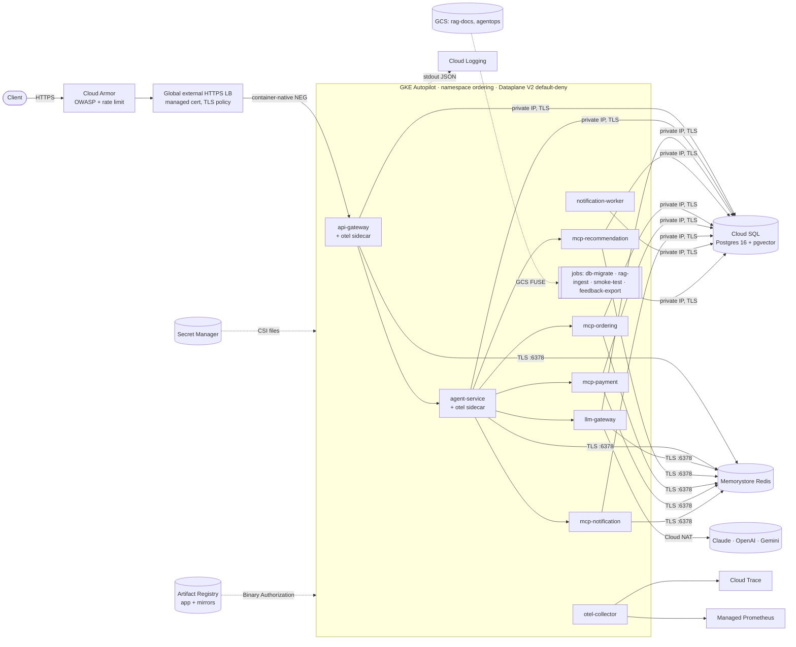
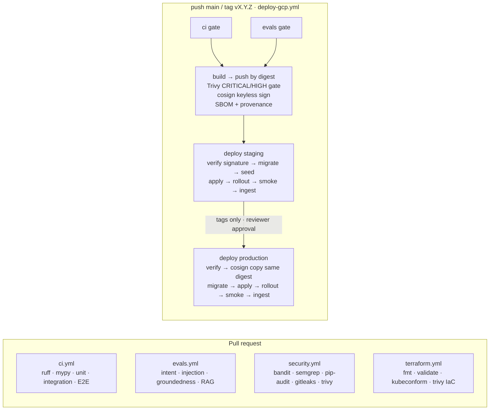

# Deploying to Google Cloud: GKE, Terraform and GitHub Actions CI/CD

This guide deploys the ordering agentic system to **Google Kubernetes Engine (Autopilot)**, with managed
data services, infrastructure as code and a gated CI/CD pipeline. Everything it references is in the
repo:

| Path | What it is |
|---|---|
| [`deploy/gcp/terraform/`](../../deploy/gcp/terraform) | All GCP infrastructure, one state per environment |
| [`deploy/gcp/scripts/`](../../deploy/gcp/scripts) | One-time bootstrap, LLM key upload, Terraform outputs → `values.env` |
| [`deploy/k8s/base/`](../../deploy/k8s/base) | Kubernetes manifests (Kustomize base) |
| [`deploy/k8s/overlays/{staging,production}/`](../../deploy/k8s/overlays) | Per-environment config (`config.env`) and infrastructure IDs (`values.env`) |
| [`deploy/k8s/components/`](../../deploy/k8s/components) | Optional parts: `staging-data` (seed + workflow smoke test), `litellm` |
| [`deploy/k8s/{render,deploy,run-job}.sh`](../../deploy/k8s) | Render → migrate → roll out → verify → auto-rollback (used by CI and by humans) |
| [`.github/workflows/deploy-gcp.yml`](../../.github/workflows/deploy-gcp.yml), [`_deploy-gke.yml`](../../.github/workflows/_deploy-gke.yml) | Application CI/CD |
| [`.github/workflows/terraform.yml`](../../.github/workflows/terraform.yml) | Infrastructure CI (static checks on PRs, plan/apply on demand) |

---

## 1. How many services run?

### Locally (Docker Compose): 16 long-running containers + 3 one-shot jobs

| Group | Containers | Count |
|---|---|---|
| Application services | `api-gateway`, `agent-service`, `llm-gateway`, `mcp-recommendation`, `mcp-ordering`, `mcp-payment`, `mcp-notification`, `notification-worker` | **8** |
| Telemetry sidecars | `api-gateway-otel`, `agent-service-otel` | 2 |
| Data stores | `postgres` (pgvector), `redis` | 2 |
| Observability | `otel-collector`, `jaeger`, `prometheus`, `grafana` | 4 |
| One-shot jobs (exit when done) | `migrate`, `seed`, `rag-ingest` | 3 |
| Optional (`--profile litellm`) | `litellm` | +1 |

All 8 application services and the 3 jobs run from **one image** (`docker/app.Dockerfile`), each with a
different command.

### On GKE: the same 8 application services; infrastructure becomes managed services

| Local container | On Google Cloud | Kind |
|---|---|---|
| 8 application services | 8 Kubernetes Deployments, each with HPA + PDB | in cluster |
| `*-otel` sidecars | native sidecars (`initContainers`, `restartPolicy: Always`) in the api-gateway and agent-service pods | in cluster |
| `otel-collector` | Deployment (2 replicas), exports to Cloud Trace + Managed Prometheus | in cluster |
| `postgres` | **Cloud SQL for PostgreSQL 16** + pgvector (private IP, TLS-only, PITR, HA in production) | managed |
| `redis` | **Memorystore for Redis 7** (AUTH + TLS, Standard HA in production) | managed |
| `jaeger` | **Cloud Trace** | managed |
| `prometheus` | **Google Cloud Managed Service for Prometheus** (`PodMonitoring`) | managed |
| `grafana` | Cloud Monitoring dashboards (the Grafana JSON is PromQL, so it imports as-is) | managed |
| stdout JSON logs | **Cloud Logging** (with `severity` and trace correlation) | managed |
| `migrate` / `seed` / `rag-ingest` | suspended CronJob templates run per deploy: `db-migrate`, `db-seed` (staging only), `rag-ingest`, plus `smoke-test` and `ops-toolbox` | in cluster |
| — | `feedback-export` nightly CronJob (AgentOps feedback loop → GCS) | in cluster |
| `litellm` (optional) | `components/litellm` Deployment | in cluster |

**Minimum pods:** staging runs **9** (1 per service + worker + collector). Production runs **22** (3× api-gateway,
agent-service and llm-gateway; 2× each MCP server; 3× worker; 2× collector). HPAs scale out from there.

---

## 2. Target architecture



### Key decisions

| Topic | Choice | Why |
|---|---|---|
| Cluster | **GKE Autopilot**, regional, private nodes | No node management; Workload Identity, Shielded Nodes, seccomp and Dataplane V2 (which enforces NetworkPolicy) are always on; pay per pod request. |
| Control-plane access | **DNS-based endpoint**, authorized by IAM | GitHub-hosted runners have changing IPs; IAM (`container.clusters.connect`) replaces an IP allowlist. |
| Secrets | **Secret Manager → GKE Secret Manager CSI add-on → files** | The app already reads `<NAME>_FILE` ([config.py](../../src/ordering/common/config.py)); no Kubernetes `Secret` objects, so no secrets in etcd. Each workload mounts only its own secrets (least privilege, enforced in IAM). |
| Pod → GCP identity | **Workload Identity Federation for GKE** (KSA principal directly in IAM) | No Google service-account keys anywhere. |
| CI → GCP identity | **Workload Identity Federation for GitHub** | No JSON keys in GitHub. The deployer for `production` can only be assumed by jobs in the `production` GitHub Environment, which carries the required-reviewer gate. |
| Database | **Cloud SQL, private IP + `ssl_mode=ENCRYPTED_ONLY`** | Simplest path that stays TLS-only and off the internet. The Cloud SQL Auth Proxy sidecar would add IAM DB auth; see §9. |
| DB roles | owner `ordering` (jobs only) + `app_user` created **in SQL** by [`scripts/db_bootstrap.py`](../../scripts/db_bootstrap.py) | Users created through the Cloud SQL API join `cloudsqlsuperuser`. The bootstrap checks that `app_user` has no superuser, no BYPASSRLS and no privileged membership, so **RLS keeps applying**. |
| Checkpoint tables | created by the `db-migrate` job ([`scripts/setup_checkpointer.py`](../../scripts/setup_checkpointer.py)); `CHECKPOINTER_AUTO_SETUP=false` | agent-service never holds owner credentials. |
| Redis | **Memorystore, AUTH + TLS**, CA mounted as a file | `REDIS_URL_FILE` carries `rediss://…?ssl_ca_certs=…`, so the app code is unchanged. |
| Images | Artifact Registry, **immutable tags, deploy by digest**, cosign keyless signatures, Trivy gate | The digest verified in staging is the digest promoted to production. |
| Third-party images | Artifact Registry **remote repositories** (Docker Hub, GHCR mirrors) | Scanned, not rate-limited, and Binary Authorization only has to allow one registry. |
| Admission | **Binary Authorization**: only `<region>-docker.pkg.dev/<project>/**` | Unknown images are blocked and audited. |
| Network | default-deny NetworkPolicies; only llm-gateway (plus IdP JWKS fetches in production) has internet egress; Google APIs through `private.googleapis.com` | Every allowed flow is an edge in the architecture diagram. |
| Edge | GKE Ingress → global LB + Google-managed cert + **Cloud Armor** (OWASP CRS, per-IP throttle, Adaptive Protection) + MODERN TLS policy | Only `/v1/*` and `/healthz` are routed; `/metrics`, `/docs` and `/readyz` stay internal. |
| Manifests | **Kustomize** base + overlays, rendered with an explicit `envsubst` allowlist | `kubectl` has Kustomize built in, so no extra tooling; config changes roll pods via hashed ConfigMap names. |
| One-shot jobs | suspended **CronJob templates** + `kubectl create job --from=cronjob/…` | Jobs are immutable; templates get the new image on every apply. |

---

## 3. Prerequisites

- Two GCP projects (recommended): e.g. `my-ordering-staging` and `my-ordering-prod`, with billing enabled.
- A human with Owner on each project, for the one-time bootstrap and first `terraform apply`.
- Tools: `gcloud`, `terraform >= 1.6`, `kubectl` (with its built-in Kustomize), `jq`, `envsubst` (gettext).
- A DNS zone where you can create `A` records for the API hostnames.
- The GitHub repository that holds this code.
- LLM provider keys (Anthropic, OpenAI, Google). Any subset works: every route falls back across providers.

---

## 4. One-time setup (per environment)

Staging is shown; repeat with `production`.

**1. Bootstrap the project and state bucket**

```bash
deploy/gcp/scripts/bootstrap.sh my-ordering-staging europe-west2
```

**2. Fill in the environment files.** In `deploy/gcp/terraform/envs/staging.tfvars`, set `project_id`, `app_host`
and `github_repository` (`owner/repo`). In `envs/staging.gcs.tfbackend`, set `bucket = "my-ordering-staging-tfstate"`.
In `production.tfvars`, nothing extra is needed. In `staging.tfvars`, set `artifact_readers` to the
production deployer (`serviceAccount:gh-deployer@<prod-project>.iam.gserviceaccount.com`), so production
can promote staging-verified images.

**3. Create the infrastructure** (about 20–30 min; Cloud SQL and GKE take the longest)

```bash
terraform -chdir=deploy/gcp/terraform init -backend-config=envs/staging.gcs.tfbackend
```

```bash
terraform -chdir=deploy/gcp/terraform apply -var-file=envs/staging.tfvars
```

**4. Add the LLM provider keys** (hidden prompt; keys never touch Terraform state or shell history)

```bash
deploy/gcp/scripts/set-llm-keys.sh my-ordering-staging
```

**5. Generate the environment identifiers** and commit them (non-secret):

```bash
deploy/gcp/scripts/write-values.sh staging
```

This writes `deploy/k8s/overlays/staging/values.env`: project, region, cluster, image repository,
hostname, static IP / Cloud Armor / SSL policy names, private services CIDR, buckets, and the WIF
provider and service accounts that CI uses.

**6. DNS.** Point `app_host` at the static IP:

```bash
terraform -chdir=deploy/gcp/terraform output api_ip_address
```

The Google-managed certificate provisions once the record resolves (usually 15–60 min).

**7. GitHub settings** (Settings → Environments)

| Environment | Used by | Protection |
|---|---|---|
| `staging` | build job + staging deploy | none, or restrict to `main` |
| `production` | production deploy | **required reviewers**; deployment tags `v*` only |
| `staging-infra`, `production-infra` | `terraform.yml` plan/apply | required reviewers |

No repository secrets are needed for GCP: authentication is keyless via WIF, and every identifier is in
`values.env`. (The `evals.yml` live mode optionally uses `ANTHROPIC_API_KEY` / `OPENAI_API_KEY` /
`GOOGLE_API_KEY` repository secrets.)

**8. First deploy.** Push to `main`, or run *deploy-gcp* manually. The first run creates everything:
namespace, identities, config, migrations, seed (staging), workloads, ingest and smoke test.

---

## 5. CI/CD pipeline



| Stage | Gate | Fails the release when… |
|---|---|---|
| `ci` | lint, types, unit (coverage floor), integration + E2E on the compose stack (mock LLM) | any test fails |
| `evals` | all eval suites vs `evals/baselines` | any metric regresses (AgentOps gate) |
| `build` | Trivy on the **pushed digest** | a fixable CRITICAL/HIGH CVE exists (the image stays unsigned, so it can't deploy) |
| `build` | cosign keyless signature | — |
| deploy | `cosign verify` bound to this repo's `deploy-gcp.yml` identity | the image isn't signed by this pipeline |
| deploy | server-side dry run of every object | the API server or admission rejects anything |
| deploy | `db-migrate` job | a migration fails (no workload has changed yet) |
| deploy | rollout status of every Deployment + in-cluster `smoke-test` | pods don't become ready, or the smoke test fails → **automatic rollback** |
| deploy | `rag-ingest` job | ingestion fails (pipeline fails; the healthy app is kept) |

**Promotion, not rebuild.** Production never builds. It verifies the staging-signed digest, then
`cosign copy`s the image with its signatures into the production registry. The digest is unchanged,
and production deploys `…@sha256:<same digest>`.

**Staging smoke test** (`components/staging-data`) mints a short-lived token in-cluster. It then holds a real,
read-only conversation (recommendations → read back → close/cache cleanup) against the seeded demo tenants. **Production**
runs the health smoke test only. It never uses dummy data or dev tokens.

---

## 6. What a deploy does

[`deploy/k8s/deploy.sh`](../../deploy/k8s/deploy.sh) `<env> <image@digest>` runs these steps:

1. **Render** the overlay ([`render.sh`](../../deploy/k8s/render.sh)) and fail on any unsubstituted placeholder.
2. **Server-side dry run** of all objects.
3. **Phase `pre`**: apply the namespace, ServiceAccounts, ConfigMaps, SecretProviderClasses, job templates and base NetworkPolicies.
4. **`db-migrate`**: `db_bootstrap` (extensions + `app_user`, password from Secret Manager) → `alembic upgrade head` → `setup_checkpointer`. Then **`db-seed`** runs in staging.
5. **Apply everything**, then wait for every Deployment rollout.
6. **`smoke-test`** job. If step 5 or 6 fails, every Deployment runs `kubectl rollout undo`.
7. **`rag-ingest`** from the environment's GCS bucket (idempotent: unchanged docs are skipped by SHA-256).

You can run the same thing by hand (after `gcloud container clusters get-credentials … --dns-endpoint`):

```bash
deploy/k8s/deploy.sh staging europe-west2-docker.pkg.dev/my-ordering-staging/ordering/ordering-app@sha256:<digest>
```

**Migrations must be expand-only** (add columns, tables and indexes; backfill in code). Old pods keep running
during the rollout, and a rollback only reverts pods, never schema. Destructive changes ship as a later
"contract" release.

---

## 7. Day-2 operations

| Task | How |
|---|---|
| Roll back the app | Re-run *deploy-gcp* on the previous tag, or `kubectl -n ordering rollout undo deploy/<name>` (pods only, never schema) |
| Rotate an LLM key | `deploy/gcp/scripts/set-llm-keys.sh <project>` → `kubectl -n ordering rollout restart deploy/llm-gateway` |
| Rotate generated secrets | `terraform apply -replace=random_password.jwt` (or `service_jwt`) → `kubectl -n ordering rollout restart deploy`. Secrets are read at pod start. For `db_app`, run `deploy/k8s/run-job.sh db-migrate` first (it re-applies the `app_user` password), then restart. Existing pods fail new DB connections until they restart, so rotate in a quiet window |
| Prompt canary (AgentOps) | `deploy/k8s/run-job.sh ops-toolbox -- python -m ordering.prompts.rollouts set intent_classifier 1.1.0 10`, then `… rollouts clear intent_classifier` to roll back |
| Feedback loop | `feedback-export` writes `gs://<project>-ordering-agentops/eval-candidates/<date>.jsonl` nightly. Reviewed cases go into `evals/datasets/*.jsonl` via PR; `evals.yml` then gates future changes on them |
| Update RAG documents | Upload to `gs://<project>-ordering-rag-docs/…` (production content owners), then `deploy/k8s/run-job.sh rag-ingest 1800`. In staging, CI syncs `data/rag_docs` |
| Switch to LiteLLM | Uncomment `components/litellm` in the overlay and deploy (sets `LLM_BACKEND=litellm`; the in-house gateway stays the entry point) |
| Scale | Adjust HPA min/max in the overlay patches. Keep `Σ(pods × DB_POOL_SIZE)` below `db_max_connections` |
| Backups / DR | Cloud SQL automated backups + PITR (7-day WAL), 14 or 30 days retention; restore with `gcloud sql backups restore` or clone to a point in time. Redis holds only rebuildable state (caches, locks, budgets) |
| Chaos in staging | `POST /v1/dev/faults` (admin; ignored when `ENV=production`) |
| Cluster upgrades | Autopilot auto-upgrades on the release channel (REGULAR for staging, STABLE for production) inside the weekend maintenance window; PDBs keep capacity |

---

## 8. Security model on GCP

| Control | Where |
|---|---|
| No keys: CI uses GitHub OIDC → WIF, pods use Workload Identity | `iam.tf` |
| Per-workload secret access (7 identities, each limited to its own secrets) | `iam.tf` `ksa_secrets` ↔ `secretproviderclasses.yaml` |
| Owner DB credentials only in `ordering-jobs` | `secretproviderclasses.yaml` |
| RLS always applies at runtime (`app_user` verified non-privileged) | `scripts/db_bootstrap.py` |
| TLS to Cloud SQL and Redis; no public IPs on data services | `data.tf` |
| Pod Security Admission `restricted`; non-root UID 10001, read-only root FS, all capabilities dropped, seccomp | `namespace.yaml`, all workloads |
| Default-deny NetworkPolicies, explicit flows only | `networkpolicies.yaml` |
| Binary Authorization (project registry only) + cosign verification in CD | `gke.tf`, `_deploy-gke.yml` |
| Cloud Armor WAF + per-IP throttle; the app keeps per-user rate limits, authN/Z, injection defenses | `edge.tf` |
| Audit: Cloud Audit Logs, pgaudit, app audit events (`GET /v1/audit`), LB request logs | `data.tf`, app |
| Shift-left: Trivy image + IaC gates, kubeconform, actionlint, bandit, semgrep, pip-audit, gitleaks | workflows |

Trivy exceptions are listed with their justification in [`.trivyignore`](../../.trivyignore).

---

## 9. Hardening options (not enabled by default)

- **Require signed attestations** at admission: add a Binary Authorization attestor fed by the cosign signature (or KMS-signed attestations) and switch `default_admission_rule` to `REQUIRE_ATTESTATION`.
- **IAM database authentication** through the Cloud SQL Auth Proxy (native sidecar) instead of passwords.
- **FQDN egress policies** (GKE `FQDNNetworkPolicy`) so llm-gateway can only reach `api.anthropic.com`, `api.openai.com` and `generativelanguage.googleapis.com`.
- **CMEK** for Cloud SQL, Secret Manager, Artifact Registry and GCS; **VPC Service Controls** perimeter.
- **Cloud Service Mesh** for mTLS between pods (today, MCP calls carry signed per-call service tokens, and NetworkPolicy restricts callers).
- A managed **Grafana** (or Cloud Monitoring import of `docker/grafana/dashboards/agentops.json`) plus alerting policies and SLOs.
- Replace the notification queue table with **Pub/Sub** once volume warrants it.

---

## 10. Troubleshooting

| Symptom | Likely cause and fix |
|---|---|
| Pods stuck in `ContainerCreating` with `failed to mount secrets` | A secret has no version (usually an LLM key; run `set-llm-keys.sh`), or the IAM binding is missing (`terraform apply`) |
| `db-migrate` fails with `app_user is privileged` | `app_user` was created through the Cloud SQL console/API. Drop it in SQL and re-run the job |
| agent-service not ready: `/readyz` 500 | DB or Redis unreachable. Check `PRIVATE_SERVICES_CIDR` in `values.env` matches Terraform, and the Redis CA file is mounted |
| Ingress has no address, or the cert stays `Provisioning` | DNS not pointing at the static IP yet; `kubectl -n ordering describe managedcertificate api-gateway` |
| 403 from the LB on legitimate traffic | A Cloud Armor rule matched. Check LB logs (`jsonPayload.enforcedSecurityPolicy`) and tune `sensitivity` or add an exclusion |
| `rag-ingest` / `feedback-export` pods rejected by PodSecurity | The injected GCS FUSE sidecar must satisfy `restricted`. Check `kubectl -n ordering get events`; if your GKE version's sidecar doesn't comply, label the namespace `enforce: baseline` and keep `warn/audit: restricted` |
| Image rejected at admission | It isn't from this project's Artifact Registry (Binary Authorization). Use the mirrors or push to `ordering` |
| CI can't reach the cluster | The deployer lacks `roles/container.developer`, or `get-gke-credentials` isn't using `dns_based_endpoint: true` |
| `render.sh: unsubstituted ${…}` | `values.env` is missing a key; regenerate it with `write-values.sh` |

---

## 11. Verification status

Checked locally:

- **Manifests.** Both overlays render. All 136 objects pass `kubeconform -strict` against Kubernetes 1.32 plus the GKE CRD schemas (SecretProviderClass, ManagedCertificate, BackendConfig, FrontendConfig, PodMonitoring). The LiteLLM component renders and validates too.
- **Container under GKE restrictions.** The rebuilt image ran with a read-only root FS, UID 10001, all capabilities dropped, `no-new-privileges`, secrets from files (`*_FILE`), offline model cache, and **no owner DB credentials** in agent-service. The full workflow smoke test passed through api-gateway → agent-service → MCP → Postgres/Redis, and the ONNX reranker scored passages on the read-only filesystem.
- **Scripts.** `db_bootstrap`, `setup_checkpointer` and `smoke_test --mode workflow` ran against the local stack. All shell scripts pass `shellcheck`.
- **Terraform.** `fmt -check` and `validate` pass (google provider 6.50).
- **Static scans.** Trivy IaC on the rendered manifests plus Terraform: 0 findings at MEDIUM+ after the justified ignores. `actionlint` passes on all workflows.

Not verified: an actual `terraform apply`, a GKE deployment, and a GitHub Actions run. These need GCP
projects and a GitHub repository. The first real apply may surface project-specific issues such as org
policies, quotas or API enablement delays. The troubleshooting table covers the common ones.
